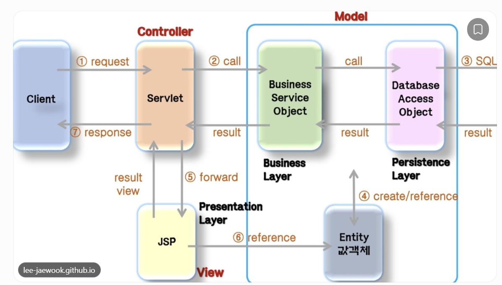

can you give step by step flow/instruction to create a servlet java app covering below concepts in vs code linux env

request dispatching
passing data to html
passing data from one servlet to another
crud operation using jdbc
jsp html

mvc

---

# Build a Java Servlet + JSP + JDBC CRUD Application in VS Code (Linux)

Let's build one complete Student Management System using Java, Servlet, JSP, JDBC, MySQL and MVC.

The application will cover all the concepts you mentioned through a single practical project rather than creating separate examples for each concept.

Recommended stack

| Technology          | Purpose                         |
| ------------------- | ------------------------------- |
| Java 21             | Programming language            |
| Maven               | Dependency management and build |
| Apache Tomcat 10.1  | Servlet container               |
| Jakarta Servlet 6.0 | Handle HTTP requests            |
| JSP                 | Dynamic HTML pages              |
| JDBC                | Database connectivity           |
| MySQL               | Store student records           |
| VS Code             | Development environment         |

We'll use Jakarta Servlet (`jakarta.servlet.*`), not the older `javax.servlet.*` package, because we're using Tomcat 10.1.

## 1. Understand what we are building



[Unserstanding JavaServer Page Model 1 and Model 2(MVC) Architecture](https://images.openai.com/static-rsc-4/FoKIwEcDHoLf_bLvcTlSJpOGcbhRKxxUMBC_3i-E3NJav5XQbFgvuPi4ZtG_Hdmu9ivldqjEZZ3m38mR9g4bm3EC4RLA1MuKZAXCplXBs4o1FzwwWE3tRAC5LkgkvScjNHkEjsiyTNdPgOohUivzvoVAYyXJrK87sBKgn08HFWU?purpose=inline)

[lee-jaewook.github.io](https://lee-jaewook.github.io/p/mvc-architecture/?utm_source=chatgpt.com)

Our application will support:

1. Display all students.
2. Add a new student.
3. Edit student details.
4. Delete a student.
5. View individual student details.

### Concepts covered

| Concept                       | Where we implement it              |
| ----------------------------- | ---------------------------------- |
| Request dispatching           | `RequestDispatcher.forward()`      |
| Passing data to HTML          | `request.setAttribute()`           |
| Passing data between servlets | `request.getRequestDispatcher()`   |
| Redirecting requests          | `response.sendRedirect()`          |
| JDBC                          | Database connection and CRUD       |
| JSP + HTML                    | Dynamic frontend                   |
| MVC                           | Model, View and Controller         |
| Servlet lifecycle             | `init()`, `service()`, `destroy()` |

## 2. Understand the application architecture

We will follow MVC architecture.

Model

- Student.java
- StudentDAO.java

View

- JSP pages
- HTML forms and tables
- CSS

Controller

- StudentServlet.java
- Handles incoming HTTP requests.
- Calls DAO methods.
- Passes data to JSP.

Database

\- MySQL student table.

The request flow will be:

1. Browser sends a request.
2. Tomcat receives the request.
3. Servlet acts as the controller.
4. Controller calls DAO.
5. DAO communicates with MySQL using JDBC.
6. Controller receives the result.
7. Controller forwards the data to JSP.
8. JSP generates HTML.
9. Browser displays the response.

## 3. Set up the Linux environment

Since you're using VS Code in a Linux environment, open the terminal.

### Step 1: Verify Java

```
java -version
javac -version
```

Expected: Java 21.

### Step 2: Verify Maven

```
mvn -version
```

### Step 3: Verify MySQL

```
sudo service mysql start
sudo mysqladmin ping
```

Expected:

```
mysqld is alive
```

### Step 4: Install Tomcat 10.1

If you're using a Linux environment where Tomcat isn't already installed:

```
sudo apt update
sudo apt install tomcat10
```

Verify:

```
sudo systemctl status tomcat10
```

If your environment doesn't support `systemctl` (for example, a container or Codespaces), you can run Tomcat using its downloaded distribution instead.

Note: Tomcat 10.1 requires Java 11 or newer.

## 4. Create the Maven web application

Create a project directory:

```
mkdir student-management
cd student-management
```

Open it in VS Code:

```
code .
```

Create the following `pom.xml`.

pom.xml

```
<project xmlns="http://maven.apache.org/POM/4.0.0"
         xmlns:xsi="http://www.w3.org/2001/XMLSchema-instance"
         xsi:schemaLocation="http://maven.apache.org/POM/4.0.0
         https://maven.apache.org/xsd/maven-4.0.0.xsd">

    <modelVersion>4.0.0</modelVersion>

    <groupId>com.example</groupId>
    <artifactId>student-management</artifactId>
    <version>1.0-SNAPSHOT</version>

    <packaging>war</packaging>

    <properties>
        <maven.compiler.release>21</maven.compiler.release>
        <project.build.sourceEncoding>UTF-8</project.build.sourceEncoding>
    </properties>

    <dependencies>

        <!-- Servlet API -->
        <dependency>
            <groupId>jakarta.servlet</groupId>
            <artifactId>jakarta.servlet-api</artifactId>
            <version>6.0.0</version>
            <scope>provided</scope>
        </dependency>

        <!-- MySQL JDBC Driver -->
        <dependency>
            <groupId>com.mysql</groupId>
            <artifactId>mysql-connector-j</artifactId>
            <version>9.3.0</version>
        </dependency>

        <!-- JSP API -->
        <dependency>
            <groupId>jakarta.servlet.jsp</groupId>
            <artifactId>jakarta.servlet.jsp-api</artifactId>
            <version>3.1.1</version>
            <scope>provided</scope>
        </dependency>

    </dependencies>

    <build>
        <finalName>student-management</finalName>
    </build>

</project>
```

Run:

```
mvn clean package
```

This creates a WAR-based web application.

## 5. Create the MySQL database

Open MySQL:

```
sudo mysql
```

Create the database and table:

```
CREATE DATABASE student_db;

USE student_db;

CREATE TABLE students (
    id INT PRIMARY KEY AUTO_INCREMENT,
    name VARCHAR(100) NOT NULL,
    email VARCHAR(100) UNIQUE NOT NULL,
    course VARCHAR(100) NOT NULL
);
```

Insert sample data:

```
INSERT INTO students (name, email, course)
VALUES
('Arun', 'arun@gmail.com', 'Java'),
('Mani', 'mani@gmail.com', 'Spring Boot');
```

Verify:

```
SELECT * FROM students;
```

Exit:

```
EXIT;
```

## 6. Create the project folder structure

Create the following structure in VS Code.

```
student-management/
│
├── pom.xml
│
└── src/
    └── main/
        ├── java/
        │   └── com/
        │       └── example/
        │           ├── model/
        │           │   └── Student.java
        │           │
        │           ├── dao/
        │           │   └── StudentDAO.java
        │           │
        │           ├── util/
        │           │   └── DBConnection.java
        │           │
        │           └── controller/
        │               ├── StudentServlet.java
        │               └── StudentSummaryServlet.java
        │
        └── webapp/
            └── WEB-INF/
                └── views/
                    ├── students.jsp
                    ├── student-form.jsp
                    └── student-summary.jsp
```

Why this structure?

| Folder        | Responsibility           |
| ------------- | ------------------------ |
| model         | Java entity classes      |
| dao           | JDBC database operations |
| util          | Database connection      |
| controller    | Servlets                 |
| WEB-INF/views | JSP pages                |

JSP files inside `WEB-INF` cannot be directly accessed through a browser URL. They must be accessed through a servlet, which is useful for implementing MVC.

## 7. Implement the Model layer

Create `Student.java`.

```
package com.example.model;

public class Student {

    private int id;
    private String name;
    private String email;
    private String course;

    public Student() {
    }

    public Student(int id, String name, String email, String course) {
        this.id = id;
        this.name = name;
        this.email = email;
        this.course = course;
    }

    public Student(String name, String email, String course) {
        this.name = name;
        this.email = email;
        this.course = course;
    }

    public int getId() {
        return id;
    }

    public void setId(int id) {
        this.id = id;
    }

    public String getName() {
        return name;
    }

    public void setName(String name) {
        this.name = name;
    }

    public String getEmail() {
        return email;
    }

    public void setEmail(String email) {
        this.email = email;
    }

    public String getCourse() {
        return course;
    }

    public void setCourse(String course) {
        this.course = course;
    }
}
```

Concepts covered:

- Java POJO.
- Encapsulation.
- Constructors.
- Getters and setters.
- Model representation of database records.

## 8. Implement JDBC database connectivity

Create `DBConnection.java`.

```
package com.example.util;

import java.sql.Connection;
import java.sql.DriverManager;
import java.sql.SQLException;

public class DBConnection {

    private static final String URL =
        "jdbc:mysql://localhost:3306/student_db";

    private static final String USER =
        System.getenv("DB_USER");

    private static final String PASSWORD =
        System.getenv("DB_PASSWORD");

    public static Connection getConnection()
            throws SQLException {

        return DriverManager.getConnection(
            URL, USER, PASSWORD
        );
    }
}
```

Set your database credentials in the Linux terminal:

```
export DB_USER="your_mysql_username"
export DB_PASSWORD="your_mysql_password"
```

For a local development database, you can create a dedicated MySQL user and grant it access to `student_db`, rather than using the root account.

JDBC concepts covered:

- DriverManager
- Connection
- SQL execution
- Database connectivity
- SQLException
- Try-with-resources

## 9. Implement DAO layer – JDBC CRUD operations

Create `StudentDAO.java`.

This class is responsible for communicating with MySQL.

```
package com.example.dao;

import com.example.model.Student;
import com.example.util.DBConnection;

import java.sql.*;
import java.util.*;

public class StudentDAO {

    // CREATE
    public void save(Student student) throws SQLException {

        String sql = """
            INSERT INTO students(name, email, course)
            VALUES (?, ?, ?)
        """;

        try (Connection con = DBConnection.getConnection();
             PreparedStatement ps = con.prepareStatement(sql)) {

            ps.setString(1, student.getName());
            ps.setString(2, student.getEmail());
            ps.setString(3, student.getCourse());

            ps.executeUpdate();
        }
    }

    // READ ALL
    public List<Student> findAll() throws SQLException {

        List<Student> students = new ArrayList<>();

        String sql = "SELECT * FROM students";

        try (Connection con = DBConnection.getConnection();
             PreparedStatement ps = con.prepareStatement(sql);
             ResultSet rs = ps.executeQuery()) {

            while (rs.next()) {

                Student student = new Student(
                    rs.getInt("id"),
                    rs.getString("name"),
                    rs.getString("email"),
                    rs.getString("course")
                );

                students.add(student);
            }
        }

        return students;
    }

    // READ BY ID
    public Student findById(int id) throws SQLException {

        String sql = "SELECT * FROM students WHERE id = ?";

        try (Connection con = DBConnection.getConnection();
             PreparedStatement ps = con.prepareStatement(sql)) {

            ps.setInt(1, id);

            try (ResultSet rs = ps.executeQuery()) {

                if (rs.next()) {
                    return new Student(
                        rs.getInt("id"),
                        rs.getString("name"),
                        rs.getString("email"),
                        rs.getString("course")
                    );
                }
            }
        }

        return null;
    }

    // UPDATE
    public void update(Student student) throws SQLException {

        String sql = """
            UPDATE students
            SET name = ?, email = ?, course = ?
            WHERE id = ?
        """;

        try (Connection con = DBConnection.getConnection();
             PreparedStatement ps = con.prepareStatement(sql)) {

            ps.setString(1, student.getName());
            ps.setString(2, student.getEmail());
            ps.setString(3, student.getCourse());
            ps.setInt(4, student.getId());

            ps.executeUpdate();
        }
    }

    // DELETE
    public void delete(int id) throws SQLException {

        String sql = "DELETE FROM students WHERE id = ?";

        try (Connection con = DBConnection.getConnection();
             PreparedStatement ps = con.prepareStatement(sql)) {

            ps.setInt(1, id);

            ps.executeUpdate();
        }
    }
}
```

Important JDBC methods:

| Method               | Purpose                        |
| -------------------- | ------------------------------ |
| `getConnection()`    | Establish DB connection        |
| `prepareStatement()` | Prepare SQL query              |
| `setString()`        | Set string parameter           |
| `setInt()`           | Set integer parameter          |
| `executeQuery()`     | Execute SELECT                 |
| `executeUpdate()`    | Execute INSERT, UPDATE, DELETE |
| `ResultSet`          | Read query results             |

Notice that we use `PreparedStatement` instead of concatenating SQL strings. This helps prevent SQL injection.

## 10. Implement the Controller – StudentServlet

Create `StudentServlet.java`.

This is the central controller of our application.

It receives HTTP requests, calls DAO methods and forwards results to JSP.

```
package com.example.controller;

import com.example.dao.StudentDAO;
import com.example.model.Student;

import jakarta.servlet.ServletException;
import jakarta.servlet.annotation.WebServlet;
import jakarta.servlet.http.*;

import java.io.IOException;
import java.sql.SQLException;

@WebServlet("/students")
public class StudentServlet extends HttpServlet {

    private StudentDAO studentDAO;

    @Override
    public void init() {
        studentDAO = new StudentDAO();
    }

    @Override
    protected void doGet(
            HttpServletRequest request,
            HttpServletResponse response)
            throws ServletException, IOException {

        String action = request.getParameter("action");

        try {

            if ("new".equals(action)) {

                request.getRequestDispatcher(
                    "/WEB-INF/views/student-form.jsp"
                ).forward(request, response);

            } else if ("edit".equals(action)) {

                int id = Integer.parseInt(
                    request.getParameter("id")
                );

                Student student = studentDAO.findById(id);

                if (student == null) {
                    response.sendError(404, "Student not found");
                    return;
                }

                request.setAttribute("student", student);

                request.getRequestDispatcher(
                    "/WEB-INF/views/student-form.jsp"
                ).forward(request, response);

            } else if ("summary".equals(action)) {

                request.setAttribute(
                    "message", "Data received from StudentServlet"
                );

                request.getRequestDispatcher(
                    "/student-summary"
                ).forward(request, response);

            } else {

                request.setAttribute(
                    "students", studentDAO.findAll()
                );

                request.getRequestDispatcher(
                    "/WEB-INF/views/students.jsp"
                ).forward(request, response);
            }

        } catch (SQLException | NumberFormatException e) {
            throw new ServletException(e);
        }
    }

    @Override
    protected void doPost(
            HttpServletRequest request,
            HttpServletResponse response)
            throws ServletException, IOException {

        String action = request.getParameter("action");

        try {

            if ("create".equals(action)) {

                Student student = new Student(
                    request.getParameter("name"),
                    request.getParameter("email"),
                    request.getParameter("course")
                );

                studentDAO.save(student);

            } else if ("update".equals(action)) {

                Student student = new Student(
                    Integer.parseInt(request.getParameter("id")),
                    request.getParameter("name"),
                    request.getParameter("email"),
                    request.getParameter("course")
                );

                studentDAO.update(student);

            } else if ("delete".equals(action)) {

                int id = Integer.parseInt(
                    request.getParameter("id")
                );

                studentDAO.delete(id);
            }

            response.sendRedirect(
                request.getContextPath() + "/students"
            );

        } catch (SQLException | NumberFormatException e) {
            throw new ServletException(e);
        }
    }
}
```

### Concepts covered here

1\. Servlet lifecycle

- `init()` – Called once when the servlet is initialized.
- `service()` – Receives requests and dispatches them to `doGet()` or `doPost()`.
- `destroy()` – Called when the servlet is taken out of service.

2\. Request dispatching

```
request.getRequestDispatcher(
    "/WEB-INF/views/students.jsp"
).forward(request, response);
```

Forwards the current request to another resource.

3\. Passing data to JSP

```
request.setAttribute("students", studentDAO.findAll());
```

JSP can retrieve it using:

```
${students}
```

4\. Redirecting

```
response.sendRedirect(
    request.getContextPath() + "/students"
);
```

The browser makes a new request to the specified URL.

## 11. Passing data from one servlet to another

This is a separate concept worth practising.

Create `StudentSummaryServlet.java`.

```
package com.example.controller;

import jakarta.servlet.ServletException;
import jakarta.servlet.annotation.WebServlet;
import jakarta.servlet.http.*;

import java.io.IOException;

@WebServlet("/student-summary")
public class StudentSummaryServlet extends HttpServlet {

    @Override
    protected void doGet(
            HttpServletRequest request,
            HttpServletResponse response)
            throws ServletException, IOException {

        String message = (String) request.getAttribute("message");

        request.setAttribute("receivedMessage", message);

        request.getRequestDispatcher(
            "/WEB-INF/views/student-summary.jsp"
        ).forward(request, response);
    }
}
```

In `StudentServlet`, we already have:

```
request.setAttribute(
    "message", "Data received from StudentServlet"
);

request.getRequestDispatcher(
    "/student-summary"
).forward(request, response);
```

The second servlet receives the same request object.

Important: Request attributes are available during the same request, including forwards. They are not automatically available after a redirect or in an entirely separate request.

This is how you can pass data between servlets using `RequestDispatcher`.

## 12. Create JSP pages – View layer

Before using JSTL, add these two dependencies inside your existing `pom.xml` dependencies section:

```
<dependency>
    <groupId>jakarta.servlet.jsp.jstl</groupId>
    <artifactId>jakarta.servlet.jsp.jstl-api</artifactId>
    <version>3.0.0</version>
</dependency>

<dependency>
    <groupId>org.glassfish.web</groupId>
    <artifactId>jakarta.servlet.jsp.jstl</artifactId>
    <version>3.0.1</version>
</dependency>
```

### A. students.jsp – Display students

```
<%@ taglib prefix="c" uri="jakarta.tags.core" %>

<!DOCTYPE html>
<html>
<head>
    <title>Student Management</title>
</head>
<body>

    <h2>Student Management System</h2>

    <a href="${pageContext.request.contextPath}/students?action=new">
        Add Student
    </a>

    <table border="1" cellpadding="10">

        <tr>
            <th>ID</th>
            <th>Name</th>
            <th>Email</th>
            <th>Course</th>
            <th>Actions</th>
        </tr>

        <c:forEach var="student" items="${students}">

            <tr>
                <td>${student.id}</td>
                <td><c:out value="${student.name}"/></td>
                <td><c:out value="${student.email}"/></td>
                <td><c:out value="${student.course}"/></td>

                <td>

                    <a href="${pageContext.request.contextPath}/students?action=edit&id=${student.id}">
                        Edit
                    </a>

                    <form action="${pageContext.request.contextPath}/students"
                          method="post">

                        <input type="hidden"
                               name="action"
                               value="delete">

                        <input type="hidden"
                               name="id"
                               value="${student.id}">

                        <button type="submit">Delete</button>

                    </form>

                </td>
            </tr>

        </c:forEach>

    </table>

</body>
</html>
```

### B. student-form.jsp – Add and update students

```
<!DOCTYPE html>
<html>
<head>
    <title>Student Form</title>
</head>
<body>

    <h2>Student Details</h2>

    <form action="${pageContext.request.contextPath}/students"
          method="post">

        <input type="hidden"
               name="id"
               value="${student.id}">

        <input type="hidden"
               name="action"
               value="${student == null ? 'create' : 'update'}">

        Name:
        <input type="text"
               name="name"
               value="${student.name}"
               required>

        <br><br>

        Email:
        <input type="email"
               name="email"
               value="${student.email}"
               required>

        <br><br>

        Course:
        <input type="text"
               name="course"
               value="${student.course}"
               required>

        <br><br>

        <button type="submit">Save</button>

    </form>

</body>
</html>
```

### C. student-summary.jsp – Data from another servlet

```
<!DOCTYPE html>
<html>
<head>
    <title>Servlet Communication</title>
</head>
<body>

    <h2>Servlet Communication Example</h2>

    <p>Message: ${receivedMessage}</p>

    <a href="${pageContext.request.contextPath}/students">
        Back to Students
    </a>

</body>
</html>
```

JSP concepts covered:

- JSP directives.
- HTML forms.
- JSP Expression Language (EL).
- JSTL `c:forEach`.
- Dynamic data rendering.
- Reading request attributes.
- Displaying Java object properties.

Use EL and JSTL instead of Java scriptlets (`<% ... %>`) for this project.

## 13. Understand request dispatching properly

There are three important methods you should understand.

### 1. Forward

```
request.getRequestDispatcher("/WEB-INF/views/students.jsp")
       .forward(request, response);
```

- Server-side forwarding.
- Same request and response objects.
- Request attributes are preserved.
- Browser URL does not change.

### 2. Include

```
request.getRequestDispatcher("/header.jsp")
       .include(request, response);
```

- Includes the output of another resource in the current response.
- Useful for reusable headers, footers and navigation.

### 3. Redirect

```
response.sendRedirect("students");
```

- Browser receives a redirect response.
- Browser sends a new HTTP request.
- Original request attributes are not preserved.

| Feature                      | forward           | include          | redirect   |
| ---------------------------- | ----------------- | ---------------- | ---------- |
| Request                      | Same              | Same             | New        |
| Server-side                  | Yes               | Yes              | No         |
| URL changes                  | No                | No               | Yes        |
| Request attributes preserved | Yes               | Yes              | No         |
| Common usage                 | Controller to JSP | Reusable content | After CRUD |

## 14. Run the application in Tomcat

First, build the WAR:

```
mvn clean package
```

Expected output:

```
BUILD SUCCESS
```

Your WAR file:

```
target/student-management.war
```

If you installed Tomcat using apt:

```
sudo cp target/student-management.war \
/var/lib/tomcat10/webapps/
```

For the environment variables used by `DBConnection`, make sure they are available to the Tomcat process. A shell export does not automatically pass them to a systemd-managed service.

Restart Tomcat:

```
sudo systemctl restart tomcat10
```

Check:

```
sudo systemctl status tomcat10
```

If you are using a standalone Tomcat distribution, you can instead start it in the same terminal where you configured the database environment variables:

```
$CATALINA_HOME/bin/catalina.sh run
```

### Access the application

Open:

```
http://localhost:8080/student-management/students
```

If you're using VS Code Codespaces, forward port `8080` through the Ports tab and open its forwarded URL.

## 15. Test all CRUD operations

| Operation             | Action                 | Expected result                      |
| --------------------- | ---------------------- | ------------------------------------ |
| Create                | Add Student            | New record inserted                  |
| Read                  | Open Students          | All records displayed                |
| Update                | Click Edit             | Existing data populated and updated  |
| Delete                | Click Delete           | Record removed                       |
| Servlet communication | Open `?action=summary` | Message from first servlet displayed |

Test the following URLs:

```
/students
/students?action=new
/students?action=edit&id=1
/students?action=summary
```

## 16. Final MVC request flow

Keep this request flow in your notes:

Example: User opens the student list

1. Browser sends `GET /students`.
2. Tomcat maps the URL to `StudentServlet`.
3. `StudentServlet.doGet()` executes.
4. Servlet calls `StudentDAO.findAll()`.
5. DAO executes SELECT using JDBC.
6. MySQL returns records.
7. DAO returns a List of Student objects.
8. Servlet stores the list using `request.setAttribute()`.
9. Servlet forwards to `students.jsp`.
10. JSP uses EL/JSTL to render the student records.
11. Browser receives the generated HTML.

Example: User adds a student

1. Browser submits an HTML form using POST.
2. Tomcat invokes `StudentServlet.doPost()`.
3. Servlet reads form values using `request.getParameter()`.
4. Servlet creates a Student object.
5. Servlet calls `StudentDAO.save()`.
6. DAO inserts the record using JDBC.
7. Servlet redirects to `/students`.
8. Browser sends a new GET request.
9. Student list is displayed with the new record.

## 17. Recommended implementation order

Don't try to implement everything at once. Follow this order and verify each stage.

1. Project setup

   Maven WAR project, Tomcat configuration and MySQL connectivity.
2. Servlet fundamentals

   Create a simple servlet and understand GET, POST and servlet lifecycle.
3. Request dispatching

   Practise forward, include and redirect.
4. Data passing

   Practise `setAttribute()`, `getAttribute()` and `getParameter()`, including communication between two servlets.
5. JSP and HTML

   Create forms, display dynamic data using EL and JSTL.
6. JDBC

   Implement database connectivity and all CRUD operations.
7. MVC integration

   Connect Servlet → DAO → Model → JSP.
8. Final testing

   Test create, read, update, delete and servlet communication.

## 18. Important concepts to learn after completing this project

Once the application works, improve it with:

- Servlet Filters.
- Session management (`HttpSession`).
- Cookies.
- ServletContext vs ServletConfig.
- JSTL and JSP EL.
- Connection pooling (HikariCP).
- Transactions in JDBC.
- MVC exception handling.
- Authentication and authorization.
- CSRF protection and input validation.

One important note: This is a learning-oriented implementation. Before production use, add proper validation, error pages, transaction management where required, secure credential management, CSRF protection and connection pooling.

My recommendation: Build this project in the order above, and don't skip implementing JDBC yourself. Understanding how a Servlet communicates with DAO and how JSP receives request attributes will give you a strong foundation before moving to Spring MVC and Spring Boot.

I can also walk you through Phase 1 (creating the project, configuring Tomcat and running your first servlet in VS Code Linux) with exact commands and complete working files.
